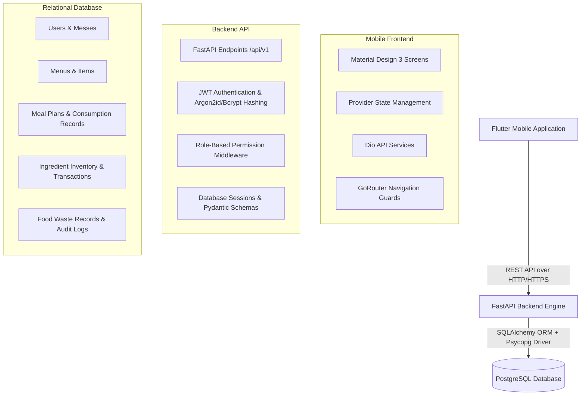

# MessMind Architecture Documentation

MessMind Phase 1 is built with a modern 3-tier mobile architecture separating UI, Business Logic, and Data Persistence.

## 1. High-Level Architecture Diagram (Mermaid)

## 2. Core Operational Data Flow
`Flutter Mobile UI -> Provider/Dio Service -> FastAPI Endpoint -> Role Security Middleware -> SQLAlchemy ORM -> PostgreSQL -> JSON Response -> Provider State -> UI Update`

## 3. Key Components
- **Mobile Application:** Flutter 3.38 with Material 3 design, GoRouter for role-based navigation guards, and Provider for state management.
- **Backend API:** FastAPI 0.110+ on Python 3.12 with async/sync SQLAlchemy 2.0 ORM and Pydantic v2 data validation.
- **Relational Persistence:** PostgreSQL 18 with Alembic migrations for database schema version control.
